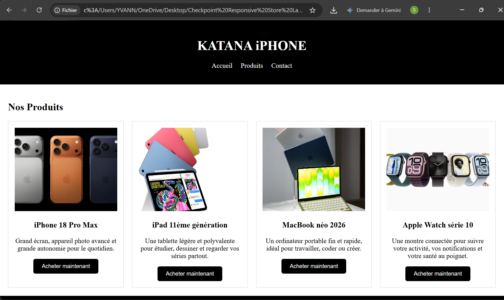
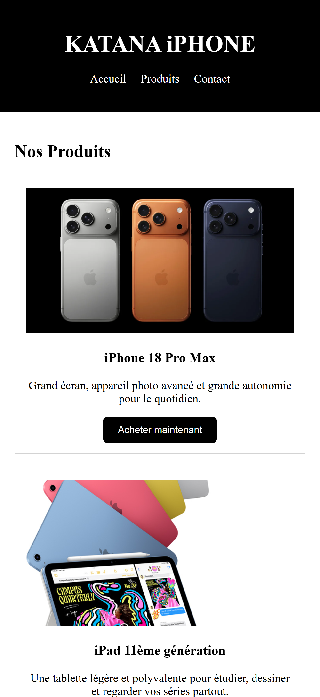

# KATANA IPHONE - Page d'atterrissage responsive

Auteur : SAMBOLY YVAN

Page d'atterrissage d'une boutique en ligne fictive d'appareils Apple (iPhone, iPad, MacBook, Apple Watch). La page s'adapte à deux tailles d'écran : mobile, tablette et ordinateur.

## Technologies

- HTML5 (balises sémantiques)
- CSS3 (Grid, Flexbox, Media Queries)

## Structure de la page

- **En-tête** : nom de la boutique et menu de navigation avec des liens vers les sections de la page (Accueil, Produits, Contact)
- **Section produits** : 4 fiches produits, chacune avec une image, un nom, une brève description et un bouton "Acheter maintenant"
- **Pied de page** : informations de contact

Balises utilisées : `header`, `nav`, `main`, `section`, `article`, `footer`.

## Choix de conception

- **Mobile First** : les styles de base sont pensés pour un téléphone (une seule colonne). Des Media Queries `min-width` améliorent ensuite l'affichage : 2 colonnes à partir de 768px, 4 colonnes à partir de 1024px.
- **CSS Grid pour les produits** : `grid-template-columns`, `repeat()` et `gap` répartissent les fiches de façon régulière sans avoir à ajouter de marges sur chaque fiche.
- **Fiches réutilisables** : toutes les fiches partagent la classe `carte-produit` plutôt qu'un `id`, car la même structure se répète 4 fois.
- **Images homogènes** : hauteur fixe de 200px avec `object-fit: cover`, pour que les 4 fiches aient la même allure malgré des photos de proportions différentes.
- **Menu en Flexbox** : les liens sont alignés en ligne et centrés, sans puces.
- **Style** : en-tête et pied de page sombres, boutons aux coins arrondis avec une transition de couleur au survol.
- **Accessibilité et bonnes pratiques** : attribut `alt` sur chaque image, `lang="fr"`, balise `viewport`, chemins relatifs avec `/`, code commenté.

## Problèmes rencontrés et solutions

1. **Images trop grandes et de tailles inégales.** `max-width: 100%` empêchait seulement le débordement, mais les images gardaient leur hauteur d'origine, donc les fiches n'étaient pas alignées. Solution : une hauteur fixe de 200px, `width: 100%` et `object-fit: cover` pour recadrer sans déformer.
2. **Même affichage sur mobile et sur ordinateur.** La grille était définie avec une seule colonne, quelle que soit la taille de l'écran. Solution : ajouter des Media Queries `min-width` qui passent à 2 puis 4 colonnes avec `repeat()`.
3. **Chemins d'images avec des antislashs.** Le chemin `images\fichier.webp` fonctionne sur Windows mais pas sur un serveur. Solution : utiliser le séparateur `/` standard du web.

## Tests

La page a été testée avec le mode responsive de Chrome (outils de développement) à trois tailles : environ 375px (mobile) et grand écran (ordinateur). On vérifie à chaque fois le nombre de colonnes, l'absence de débordement et la lisibilité du menu.

## Captures d'écran

